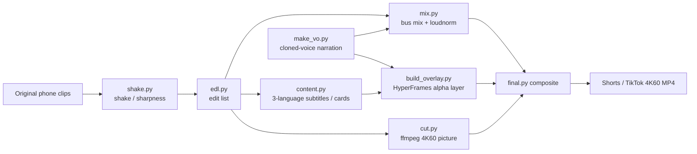

<p align="center"></p>

<h1 align="center">vlog-shorts-4k60</h1>

<p align="center">
  <a href="README.md">繁體中文</a> ·
  <b>English</b> ·
  <a href="README.zh-CN.md">简体中文</a> ·
  <a href="README.ja.md">日本語</a> ·
  <a href="README.es.md">Español</a>
</p>

<p align="center">Turn the phone clips from one outing into sharp <b>4K 60fps vertical vlog Shorts</b>, with 3-language subtitles, local-info cards, narration in your own cloned voice, and loudness-matched music. One edit list gives you both a YouTube Shorts cut and a TikTok cut.</p>

---

## What it is

This is a [Claude Code](https://claude.com/claude-code) **skill** and a project template you can run. It scripts the whole editing workflow for phone vlogs of markets, festivals, food trips and travel days:

- 📋 **Shot log**: resolution, fps and content of every clip, plus duplicate detection
- 🎯 **Shake detection**: camera speed, hand jitter and sharpness for every 0.5 s window, so you only cut from steady footage
- ✂️ **EDL**: one Python file defines the video, and the Shorts and TikTok cuts share it
- 🌏 **3-language subtitles and local-info cards** (e.g. Chinese / English / Thai), anchored to segments so captions stay in place when you retime the cut
- 🎙️ **Narration in your own voice**: optional, using fal.ai MiniMax voice cloning
- 🎵 **Mix**: separate dialogue, ambience, SFX and BGM buses; the music ducks under speech; two-pass loudnorm matches your channel's level
- 📝 **Upload text and cover**: place research, a description template, and a cover recipe

## Why it looks sharper

<p align="center"></p>

HTML-to-video tools (HyperFrames, Remotion, …) screenshot a browser frame by frame and then encode the result. Phone footage that goes this way gets transcoded one extra time, and the 1080p30 default softens it further. So the core rule here is:

> **Footage never goes through the browser.** The browser only draws text and graphics.

<p align="center"></p>

| Layer | Made with | Format |
|---|---|---|
| Picture | ffmpeg straight from the original files: lanczos upscale to 2160×3840, centre crop, light luma-only unsharp | x264 CRF 12, 60 fps |
| Graphics (titles, subtitles, cards, end card) | HyperFrames, transparent background, rendered at portrait-4k | ProRes 4444 with alpha, 60 fps |
| Sound | ffmpeg buses; BGM sidechain-ducked under speech | 48 kHz 24-bit |
| Delivery | ffmpeg overlay in yuv444, then yuv420p | x264 CRF 14, AAC 320k |

Text is never sharpened or upscaled, and footage is never re-rendered in a browser.



## Picking shots

<p align="center"></p>

`tools/shake.py` uses phase correlation to measure frame-to-frame motion and jitter for every 0.5 s window, and Laplacian variance to measure sharpness. It prints one line per clip:

```
01 VID20261112163937.mp4  13.4s | o X X o X . o o o o X X o . X o o X X X ...
04 VID20261112164137.mp4   1.6s | X o o
```

`.` steady, `o` usable, `X` too fast or shaky, `b` blurred. Cut only from `.` and short `o` windows.

## Quick start

You need ffmpeg, Python 3.10+ (`pip install opencv-python numpy fonttools`) and Node 20+. A fal.ai key is optional; it's used for narration and music.

```bash
# 1. Copy the template next to your clips (the template looks for clips in its parent folder)
cp -r template/ /path/to/clips/short && cd /path/to/clips/short

# 2. Fonts, source list, shake scan
python tools/get_fonts.py
python edl.py --sources
python tools/shake.py

# 3. Edit edl.py (the cut) and content.py (on-screen text); add assets/music/bgm.wav
#    (or generate it: FAL_KEY=... python tools/gen_audio.py)

# 4. Optional: narration in your voice
VOICE_ID=your_minimax_voice_id FAL_KEY=... python tools/make_vo.py

# 5. Preview
python tools/cut.py && python tools/build_overlay.py && python tools/subset_font.py \
  && python tools/mix.py && python tools/proxy.py
npx hyperframes preview

# 6. Render every variant
bash tools/render_all.sh            # or: bash tools/render_all.sh shorts
```

The output goes to `renders/<title>_Shorts_4K60.mp4` and `renders/<title>_TikTok_4K60.mp4`.

## Use it as a Claude Code skill

```bash
git clone https://github.com/<you>/vlog-shorts-4k60 ~/.claude/skills/vlog-shorts-4k60
```

Then ask Claude something like "cut the clips in this folder into a 4K60 Short with Chinese/English/Thai subtitles". It follows the 12 steps in [`SKILL.md`](SKILL.md): brief → research the place → shot log → shake scan → EDL → narration → captions → music → fonts → preview → render → upload text and cover.

## Layout

```
SKILL.md                 the workflow, written for Claude
template/
  edl.py                 the cut: sources, segments, variants, extra audio
  content.py             all on-screen text: hook, subtitles, cards, stickers, end card, fonts, colours
  vo/script.example.json narration script example
  tools/                 shake / cut / build_overlay / subset_font / mix / proxy / final / render_all
                         make_vo / gen_audio / fal / get_fonts
references/
  research-and-info.md   place research + upload-text template
  cover.md               cover recipe
docs/images/             README images
```

## Safety checks

- `cut.py` stops if a segment's in-point plus its duration runs past the end of its source clip. Otherwise the cut would get shorter without any warning, and every caption and audio cue would drift.
- `build_overlay.py` warns when subtitles overlap.
- API keys and voice IDs are read only from environment variables. `.gitignore` excludes `work/`, `renders/`, the voice cache and `.env`.

## License

MIT. The default fonts, Noto Sans TC and Kanit, are under the SIL Open Font License; `get_fonts.py` downloads them from google/fonts. The README illustrations were generated with meta/muse-image.
