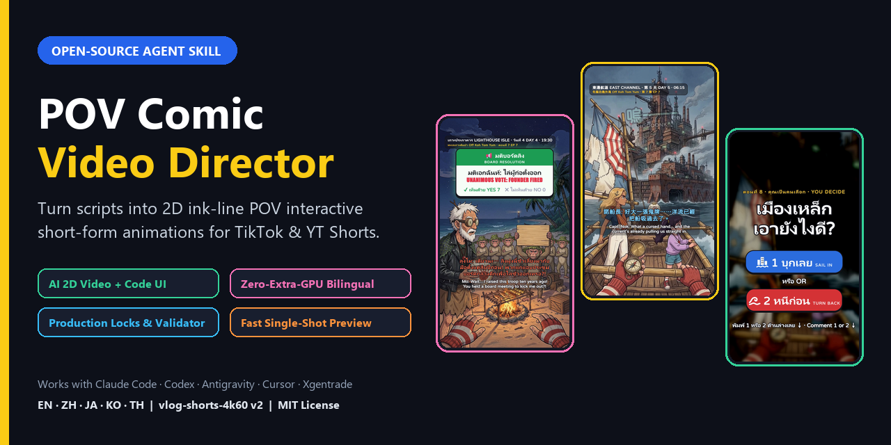
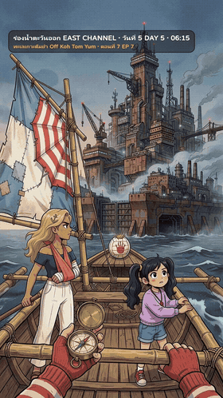
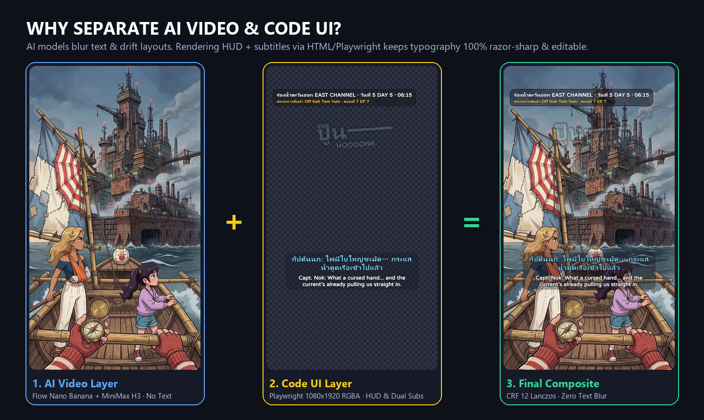
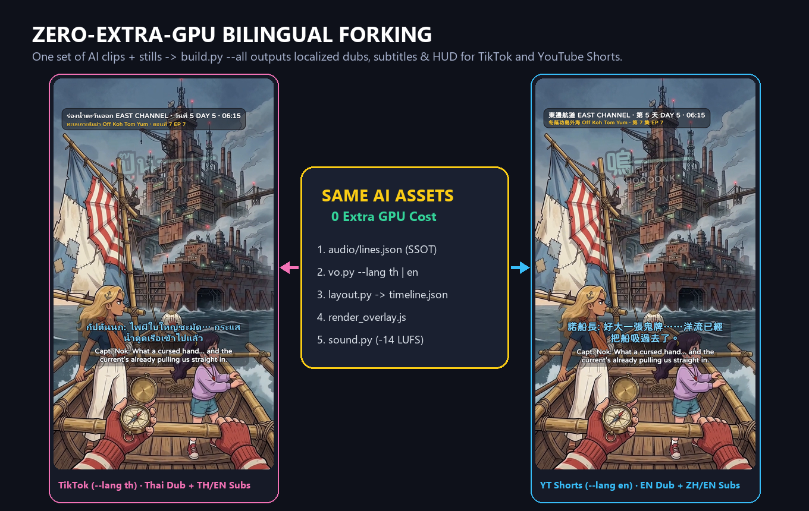
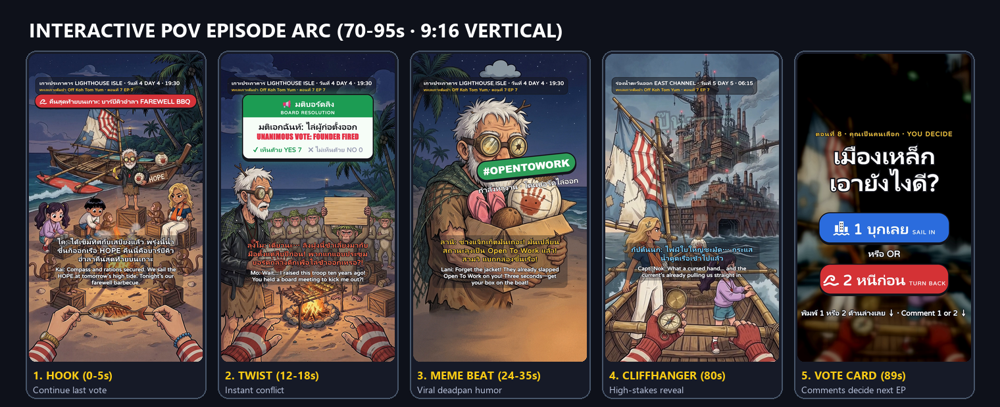
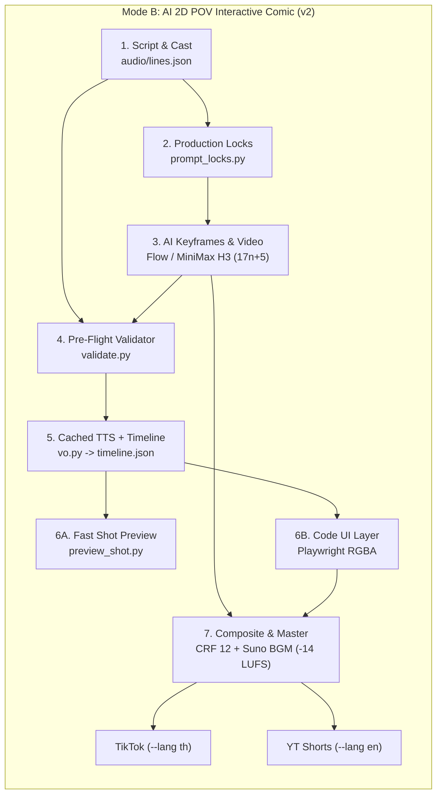

<p align="center"></p>

<h1 align="center">vlog-shorts-4k60 (v2)</h1>

<p align="center">
  <a href="README.md">繁體中文</a> ·
  <b>English</b> ·
  <a href="README.ja.md">日本語</a> ·
  <a href="README.ko.md">한국어</a> ·
  <a href="README.th.md">ภาษาไทย</a>
</p>

<p align="center">A <b>dual-mode open-source AI Agent Skill</b> (Xgentrade, Claude Code, Codex, Antigravity, Cursor) for sharp vertical short-form videos:<br><b>Mode A</b> cuts phone clips into <b>4K 60fps 3-language Vlog Shorts</b>; <b>Mode B</b> turns scripts into <b>2D ink-line POV interactive comic animations</b> with zero-extra-GPU bilingual forking for TikTok & YouTube Shorts.</p>

<p align="center"></p>

---

## Why This Pipeline Exists (One Golden Rule)

Whether you shoot phone vlogs or generate AI 2D animations, routing video footage through a browser renderer or asking AI video models to render subtitles causes **soft video, garbled text, and doubled GPU costs for multi-language publishing**. Both modes enforce one rule:

> **Footage (phone clips OR AI video) never goes through the browser, and AI never renders text.** The browser (HyperFrames / Playwright) renders ONLY a transparent RGBA UI/subtitle layer, composited onto high-bitrate footage with `ffmpeg`.

| Mode | Best For | Footage Source | Transparent UI Layer | Output |
|---|---|---|---|---|
| **Mode A: Real Vlog 4K60** (`template/`) | Markets, festivals, food, travel vlogs | Original phone files via `ffmpeg` lanczos 4K60 + `shake.py` | HyperFrames ProRes 4444 alpha | `2160×3840` 60fps (Shorts + TikTok) |
| **Mode B: AI 2D POV Comic** (`template_pov_comic/`) | Daily serialized interactive animations | Flow Nano Banana + MiniMax H3 (`17n+5` beat-locked) | Playwright `1080×1920` RGBA PNGs | `1080×1920` 30fps, `-14 LUFS` (Zero-Extra-GPU Bilingual) |

---

## Mode B (New in v2): AI 2D Ink-Line POV Interactive Comic

### 1. Separate AI Video from Code-Rendered UI
AI generates clean, text-free 2D ink-line footage (`unsharp=5:5:0.45` applied to footage ONLY). Playwright renders razor-sharp HUD badges, dual-language subtitles, and interactive voting cards on a transparent layer—zero text blur, 100% editable.

<p align="center"></p>

### 2. Zero-Extra-GPU Bilingual Forking
One set of AI clips and stills feeds a single `audio/lines.json`. Running `python build.py --all` outputs both **TikTok (`--lang th`)** and **YouTube Shorts (`--lang en`)** with localized dubs, synced timelines, and dual subtitles at **zero extra GPU cost**.

<p align="center"></p>

### 3. 5-Beat Interactive POV Episode Arc
0–5s continuity hook paying off last episode's top vote → instant conflict → deadpan comedy beats → cliffhanger → 4s binary choice card (`1` vs `2`).

<p align="center"></p>

### Architecture



### Bundled CLI Tools (`template_pov_comic/scripts/`)

| Tool | Purpose | Example |
|---|---|---|
| `validate.py` | Environment doctor (`--doctor`) & pre-flight checks (`17n+5`, banned words, missing assets) | `python template_pov_comic/scripts/validate.py <ep_dir> --lang th,en` |
| `prompt_locks.py` | Flow / MiniMax H3 style & character locks + automatic `17n+5` frame snapping | `python template_pov_comic/scripts/prompt_locks.py --frames 8.5` |
| `preview_shot.py` | Fast single-shot preview (Section-Level Revision in seconds) | `python template_pov_comic/scripts/preview_shot.py <ep_dir> --shot s2a --lang th` |

---

## Mode A: Real Phone Vlog 4K60 (`template/`)

<p align="center"></p>

- `tools/shake.py` stability & sharpness scan (0.5s windows)
- Single `edl.py` + `content.py` outputting both YouTube Shorts and TikTok 4K60 cuts
- 3-language subtitles, local-info tags, optional cloned-voice narration (`fal.ai`), sidechain-ducked BGM + 2-pass loudnorm

---

## Quick Install (Xgentrade / Claude Code / Codex / Antigravity / Cursor)

```text
Install this Skill for me: https://github.com/lovemage/vlog-shorts-4k60
```

```bash
git clone https://github.com/lovemage/vlog-shorts-4k60 ~/.claude/skills/vlog-shorts-4k60
python ~/.claude/skills/vlog-shorts-4k60/template_pov_comic/scripts/validate.py --doctor
```

## License

MIT License
