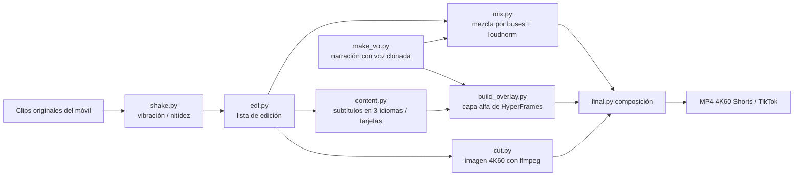

<p align="center"></p>

<h1 align="center">vlog-shorts-4k60</h1>

<p align="center">
  <a href="README.md">繁體中文</a> ·
  <a href="README.en.md">English</a> ·
  <a href="README.zh-CN.md">简体中文</a> ·
  <a href="README.ja.md">日本語</a> ·
  <b>Español</b>
</p>

<p align="center">Convierte los clips del móvil de una salida en <b>Shorts verticales de vlog en 4K a 60 fps</b> y con buena nitidez: subtítulos en 3 idiomas, tarjetas con información local, narración con tu propia voz clonada y música con el volumen ajustado. A partir de una sola lista de edición sacas la versión para YouTube Shorts y la de TikTok.</p>

---

## Qué es

Es un **skill** de [Claude Code](https://claude.com/claude-code) y también una plantilla de proyecto lista para usar. Convierte en scripts todo el flujo de edición de vlogs grabados con el móvil en mercados, festivales, rutas gastronómicas y días de viaje:

- 📋 **Registro de tomas**: resolución, fps y contenido de cada clip, además de detección de tomas repetidas
- 🎯 **Detección de vibración**: velocidad de cámara, temblor y nitidez en ventanas de 0,5 s, para cortar solo lo estable
- ✂️ **EDL (lista de edición)**: un único archivo Python define el vídeo, y las versiones Shorts y TikTok lo comparten
- 🌏 **Subtítulos en 3 idiomas y tarjetas de información local** (p. ej. chino / inglés / tailandés), anclados a los segmentos para que no se descoloquen al reeditar
- 🎙️ **Narración con tu voz**: opcional, con la clonación de voz MiniMax de fal.ai
- 🎵 **Mezcla**: buses separados para diálogo, ambiente, efectos y música; la música baja sola cuando alguien habla, y un loudnorm de dos pasadas iguala el volumen al de tu canal
- 📝 **Texto de publicación y portada**: investigación del lugar, plantilla de descripción y receta de portada

## Por qué se ve más nítido

<p align="center"></p>

Las herramientas que convierten HTML en vídeo (HyperFrames, Remotion…) hacen una captura del navegador fotograma a fotograma y luego la codifican. Si el material del móvil pasa por ahí, se recodifica una vez más, y el valor por defecto de 1080p30 lo suaviza todavía más. Por eso la regla básica de este flujo es:

> **El material nunca pasa por el navegador.** El navegador solo dibuja textos y gráficos.

<p align="center"></p>

| Capa | Cómo se hace | Formato |
|---|---|---|
| Imagen | ffmpeg directo desde los archivos originales: escalado lanczos a 2160×3840, recorte centrado, enfoque suave solo en luminancia | x264 CRF 12, 60 fps |
| Gráficos (títulos, subtítulos, tarjetas, cierre) | HyperFrames, fondo transparente, renderizado en portrait-4k | ProRes 4444 con alfa, 60 fps |
| Sonido | buses en ffmpeg; la música baja por sidechain cuando hay voz | 48 kHz, 24 bits |
| Entrega | superposición en ffmpeg en yuv444 y paso final a yuv420p | x264 CRF 14, AAC 320k |

El texto nunca se enfoca ni se escala, y el material nunca se vuelve a renderizar en un navegador.



## Cómo elegir las tomas

<p align="center"></p>

`tools/shake.py` mide con correlación de fase el movimiento y el temblor en cada ventana de 0,5 s, y la nitidez con la varianza del laplaciano. Imprime una línea por clip:

```
01 VID20261112163937.mp4  13.4s | o X X o X . o o o o X X o . X o o X X X ...
04 VID20261112164137.mp4   1.6s | X o o
```

`.` estable, `o` aprovechable, `X` demasiado rápido o tembloroso, `b` borroso. Corta solo de las ventanas `.` y de las `o` cortas.

## Inicio rápido

Necesitas ffmpeg, Python 3.10+ (`pip install opencv-python numpy fonttools`) y Node 20+. La clave de fal.ai es opcional y se usa para la narración y la música. En macOS/Linux, usa `python3` donde los comandos dicen `python`.

```bash
# 1. Copia la plantilla dentro de la carpeta de clips (la plantilla busca los clips en la carpeta superior)
cp -r template/ /path/to/clips/short && cd /path/to/clips/short

# 2. Fuentes, lista de clips y análisis de vibración
python tools/get_fonts.py
python edl.py --sources
python tools/shake.py

# 3. Edita edl.py (el montaje) y content.py (los textos en pantalla); añade assets/music/bgm.wav
#    (o genérala con: FAL_KEY=... python tools/gen_audio.py)

# 4. Opcional: narración con tu voz
cp vo/script.example.json vo/script.json   # luego escribe tu propio guion
VOICE_ID=your_minimax_voice_id FAL_KEY=... python tools/make_vo.py

# 5. Vista previa
python tools/cut.py && python tools/build_overlay.py && python tools/subset_font.py \
  && python tools/mix.py && python tools/proxy.py
npx --yes hyperframes@0.8.141 preview

# 6. Renderiza todas las versiones
bash tools/render_all.sh            # o: bash tools/render_all.sh shorts
```

El resultado queda en `renders/<title>_Shorts_4K60.mp4` y `renders/<title>_TikTok_4K60.mp4`.

## Usarlo como skill de Claude Code

```bash
git clone https://github.com/lovemage/vlog-shorts-4k60 ~/.claude/skills/vlog-shorts-4k60
```

Luego pídele a Claude algo como «monta los clips de esta carpeta en un Short 4K60 con subtítulos en chino, inglés y tailandés». Claude sigue los 12 pasos de [`SKILL.md`](SKILL.md): brief → investigar el lugar → registro de tomas → análisis de vibración → EDL → narración → subtítulos → música → fuentes → vista previa → render → texto de publicación y portada.

## Estructura

```
SKILL.md                 el flujo de trabajo, escrito para Claude
template/
  edl.py                 el montaje: clips, segmentos, versiones, audio extra
  content.py             todo el texto en pantalla: gancho, subtítulos, tarjetas, pegatinas, cierre, fuentes, colores
  vo/script.example.json ejemplo de guion de narración
  tools/                 shake / cut / build_overlay / subset_font / mix / proxy / final / render_all
                         make_vo / gen_audio / fal / get_fonts
references/
  research-and-info.md   investigación del lugar + plantilla del texto de publicación
  cover.md               receta de portada
docs/images/             imágenes del README
```

## Comprobaciones de seguridad

- `cut.py` se detiene si el punto de entrada más la duración de un segmento pasa del final de su clip. Si no, el vídeo se acortaría sin avisar y todos los subtítulos y el audio quedarían desfasados.
- `build_overlay.py` avisa cuando dos subtítulos se solapan.
- Las claves de API y el ID de voz se leen de variables de entorno (o de un `.env` ignorado por git). `.gitignore` excluye `work/`, `renders/`, la caché de voz y `.env`.

## Licencia

MIT. Las fuentes por defecto, Noto Sans TC y Kanit, tienen licencia SIL Open Font License; `get_fonts.py` las descarga de google/fonts. Las ilustraciones del README se generaron con meta/muse-image.
