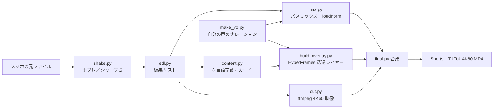

<p align="center"></p>

<h1 align="center">vlog-shorts-4k60</h1>

<p align="center">
  <a href="README.md">繁體中文</a> ·
  <a href="README.en.md">English</a> ·
  <a href="README.zh-CN.md">简体中文</a> ·
  <b>日本語</b> ·
  <a href="README.es.md">Español</a>
</p>

<p align="center">1 回のお出かけで撮ったスマホ素材を、くっきりした <b>4K 60fps の縦型 vlog Shorts</b> に仕上げます。3 言語字幕、現地の解説カード、自分の声で作った AI ナレーション、BGM、ラウドネス調整までを含み、YouTube Shorts 版と TikTok 版をまとめて書き出せます。</p>

---

## 概要

[Claude Code](https://claude.com/claude-code) の **skill** であり、そのまま動かせるプロジェクトテンプレートでもあります。マーケット、お祭り、食べ歩き、旅行などのスマホ vlog の編集手順をスクリプトにまとめています。

- 📋 **素材チェック**：クリップごとに解像度、fps、内容を読み取り、重複カットを見つけます
- 🎯 **手ブレ検出**：0.5 秒ごとにカメラの動く速さ、手ブレ、シャープさを数値化し、安定した区間だけを使います
- ✂️ **EDL（編集リスト）**：動画全体を 1 つの Python ファイルで定義し、Shorts 版と TikTok 版で共有します
- 🌏 **3 言語字幕と解説カード**：例えば中国語／英語／タイ語。字幕もカードもセグメントに紐づくので、編集を変えてもずれません
- 🎙️ **自分の声のナレーション**：任意。fal.ai MiniMax のボイスクローンを使います
- 🎵 **ミックス**：台詞・環境音・効果音・BGM を別々に処理し、声が入ると BGM が自動で下がります。2 パスの loudnorm でチャンネルの音量にそろえます
- 📝 **投稿テキストとサムネイル**：場所の下調べ、概要欄テンプレート、サムネイルの作り方

## 画質がくっきりする理由

<p align="center"></p>

HTML を動画にするツール（HyperFrames、Remotion など）は、ブラウザを 1 フレームずつスクリーンショットしてからエンコードします。スマホ素材がこの経路を通ると再エンコードが 1 回増え、デフォルトの 1080p30 でさらにぼやけます。そこで、このワークフローの基本ルールはこうです。

> **素材は絶対にブラウザを通さない。** ブラウザが描くのは文字とグラフィックだけです。

<p align="center"></p>

| レイヤー | 作り方 | 形式 |
|---|---|---|
| 映像 | ffmpeg で元ファイルから直接処理：lanczos で 2160×3840 に拡大、中央クロップ、輝度だけに軽いアンシャープ | x264 CRF 12、60 fps |
| グラフィック（タイトル、字幕、カード、情報カード） | HyperFrames、透明背景、portrait-4k で出力 | ProRes 4444（アルファ付き）、60 fps |
| 音声 | ffmpeg でバスごとにミックスし、BGM は声に合わせてサイドチェーンで下げる | 48 kHz 24-bit |
| 完成品 | ffmpeg で yuv444 のまま合成し、最後に yuv420p へ変換 | x264 CRF 14、AAC 320k |

文字にシャープがかかったり拡大されたりすることはなく、映像がブラウザで再レンダリングされることもありません。



## カットの選び方

<p align="center"></p>

`tools/shake.py` は位相相関で 0.5 秒ごとの移動速度と手ブレを測り、ラプラシアン分散でシャープさを測ります。結果はクリップごとに 1 行で表示されます。

```
01 VID20261112163937.mp4  13.4s | o X X o X . o o o o X X o . X o o X X X ...
04 VID20261112164137.mp4   1.6s | X o o
```

`.` 安定、`o` 使える、`X` 速すぎる・揺れすぎ、`b` ぼやけ。`.` と短い `o` の区間だけを使います。

## クイックスタート

必要なもの：ffmpeg、Python 3.10 以上（`pip install opencv-python numpy fonttools`）、Node 20 以上。ナレーションと BGM を使う場合は fal.ai のキーも必要です（任意）。macOS／Linux ではコマンドの `python` を `python3` に置き換えてください。

```bash
# 1. テンプレートを素材フォルダの中にコピー（素材は 1 つ上のフォルダにある前提）
cp -r template/ /path/to/clips/short && cd /path/to/clips/short

# 2. フォント、素材一覧、手ブレ解析
python tools/get_fonts.py
python edl.py --sources
python tools/shake.py

# 3. edl.py（編集）と content.py（画面の文字）を編集し、assets/music/bgm.wav を置く
#    （または FAL_KEY=... python tools/gen_audio.py で生成）

# 4. 任意：自分の声のナレーション
cp vo/script.example.json vo/script.json   # 自分の原稿に書き換える
VOICE_ID=your_minimax_voice_id FAL_KEY=... python tools/make_vo.py

# 5. プレビュー
python tools/cut.py && python tools/build_overlay.py && python tools/subset_font.py \
  && python tools/mix.py && python tools/proxy.py
npx --yes hyperframes@0.8.141 preview

# 6. 全バージョンを書き出し
bash tools/render_all.sh            # または: bash tools/render_all.sh shorts
```

完成品は `renders/<title>_Shorts_4K60.mp4` と `renders/<title>_TikTok_4K60.mp4` に出力されます。

## Claude Code の skill として使う

```bash
git clone https://github.com/lovemage/vlog-shorts-4k60 ~/.claude/skills/vlog-shorts-4k60
```

あとは Claude に「このフォルダの素材を 4K60 の Shorts にして。字幕は中国語・英語・タイ語で」のように頼むと、[`SKILL.md`](SKILL.md) の 12 ステップで進めます：ブリーフ → 場所の下調べ → 素材チェック → 手ブレ解析 → EDL → ナレーション → 字幕 → BGM → フォント → プレビュー → 書き出し → 投稿テキストとサムネイル。

## 構成

```
SKILL.md                 Claude 向けのワークフロー
template/
  edl.py                 編集リスト：素材、セグメント、バージョン、追加音声
  content.py             画面上の文字すべて：フック、字幕、カード、ステッカー、情報カード、フォント、配色
  vo/script.example.json ナレーション原稿の例
  tools/                 shake / cut / build_overlay / subset_font / mix / proxy / final / render_all
                         make_vo / gen_audio / fal / get_fonts
references/
  research-and-info.md   場所の下調べと動画情報テンプレート
  cover.md               サムネイルの作り方
docs/images/             README の画像
```

## 安全チェック

- `cut.py` は、各セグメントのイン点と長さの合計が元クリップの長さを超えていないかを最初に確認します。超えたままだと動画全体が気づかないうちに短くなり、字幕と音声がすべてずれてしまいます。
- `build_overlay.py` は字幕の重なりを警告します。
- API キーとボイス ID は環境変数（または gitignore 済みの `.env`）から読み込みます。`.gitignore` で `work/`、`renders/`、ナレーションのキャッシュ、`.env` を除外しています。

## ライセンス

MIT。デフォルトのフォント Noto Sans TC と Kanit は SIL Open Font License で、`get_fonts.py` が google/fonts からダウンロードします。README のイラストは meta/muse-image で生成しました。
