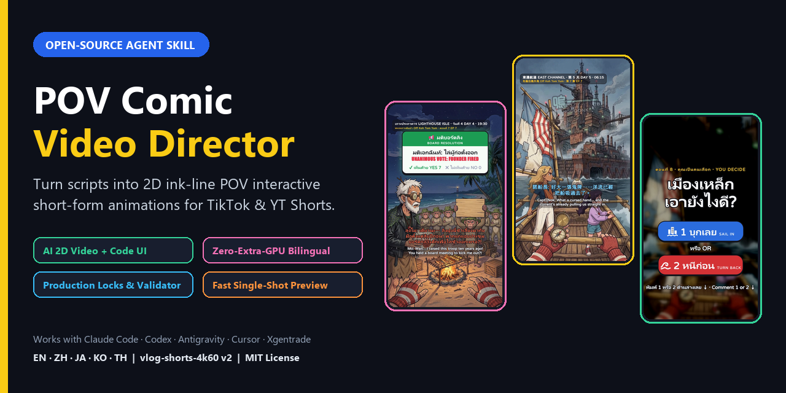
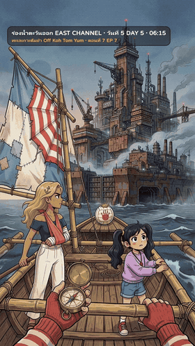
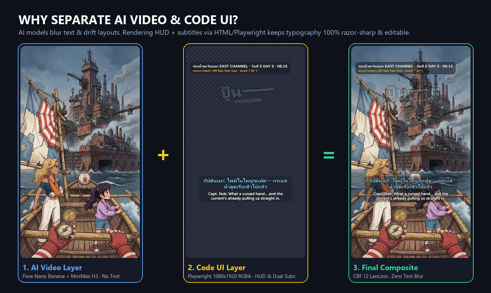
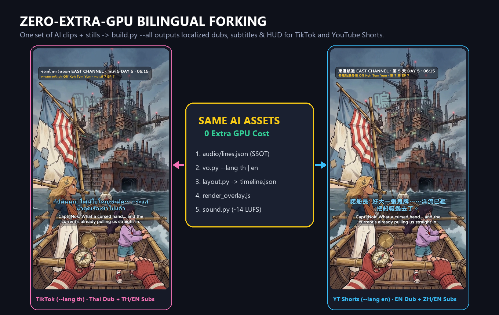
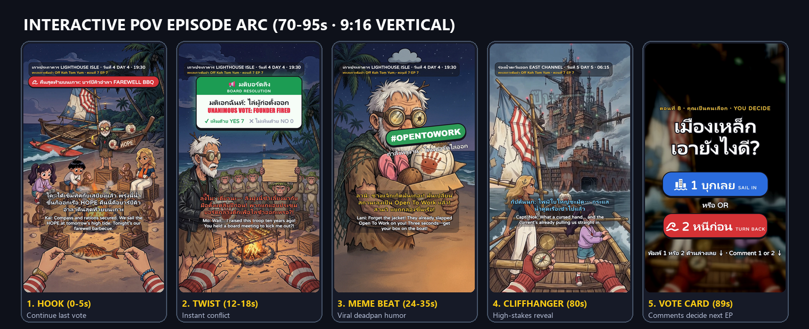
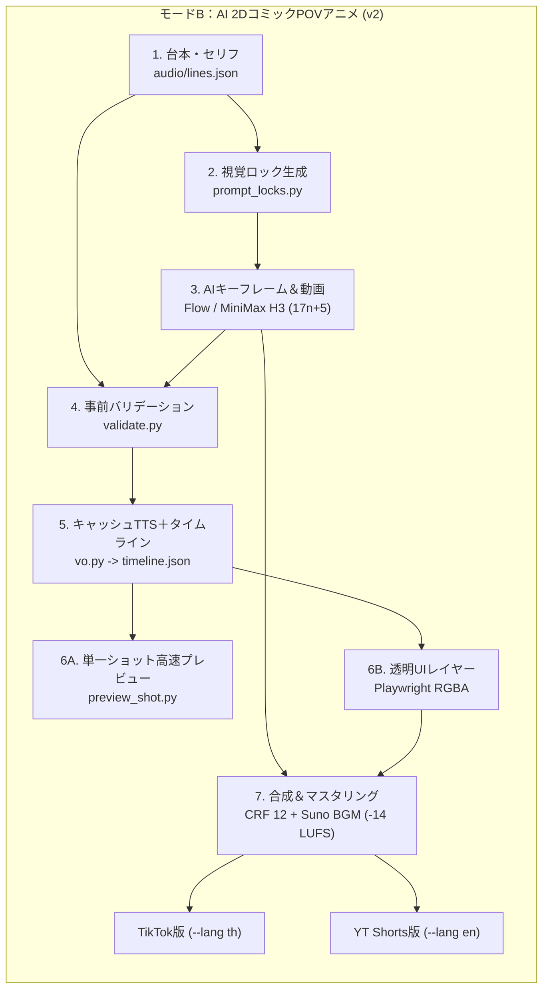

<p align="center"></p>

<h1 align="center">vlog-shorts-4k60 (v2)</h1>

<p align="center">
  <a href="README.md">繁體中文</a> ·
  <a href="README.en.md">English</a> ·
  <b>日本語</b> ·
  <a href="README.ko.md">한국어</a> ·
  <a href="README.th.md">ภาษาไทย</a>
</p>

<p align="center">Xgentrade・Claude Code・Codex・Antigravity・Cursor対応の<b>デュアルモード縦型ショート動画制作Skill</b>：<br><b>モードA</b>はスマホ実写素材を<b>4K 60fps 3言語Vlog Shorts</b>に編集、<b>モードB</b>は台本から<b>2D墨線コミックPOVインタラクティブ短編アニメ</b>を制作し、追加GPUコストゼロでTikTok・YouTube Shortsの多言語版を同時出力します。</p>

<p align="center"></p>

---

## なぜこのパイプラインなのか？

実写VlogでもAIアニメでも、映像をブラウザ経由で再エンコードしたり、AIに字幕を描かせたりすると**画質劣化・文字崩れ・多言語化コスト倍増**が起きます。両モード共通の鉄則はただ一つ：

> **映像素材（スマホ実写もAI動画も）はブラウザを通さない。AIに文字を描かせない。** ブラウザは透明なUI・字幕レイヤーだけを描画し、`ffmpeg` で高画質合成します。

### 1. AI映像とコード描画UIの完全分離
<p align="center"></p>

### 2. 追加GPUコストゼロの多言語分岐（Zero-Extra-GPU）
1セットのAI映像・静止画と `audio/lines.json` から `python build.py --all` でTikTok版（`--lang th`）とYouTube Shorts版（`--lang en`）を同時生成します。
<p align="center"></p>

### 3. コメントが次回を決める5ビート構成
<p align="center"></p>

### 全体アーキテクチャ



---

## インストール

```text
このSkillをインストールしてください: https://github.com/lovemage/vlog-shorts-4k60
```

```bash
git clone https://github.com/lovemage/vlog-shorts-4k60 ~/.claude/skills/vlog-shorts-4k60
python ~/.claude/skills/vlog-shorts-4k60/template_pov_comic/scripts/validate.py --doctor
```

## ライセンス

MIT License
