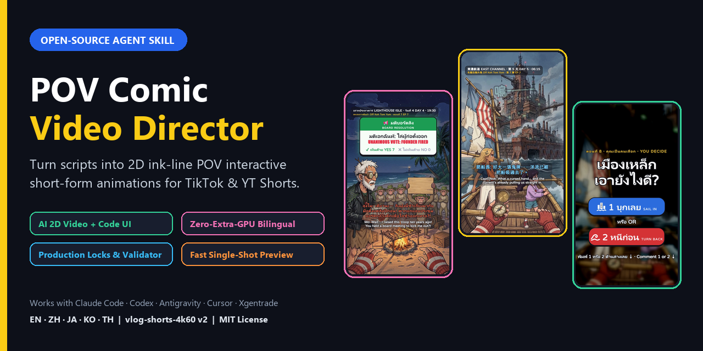
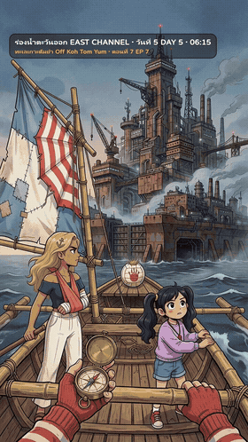
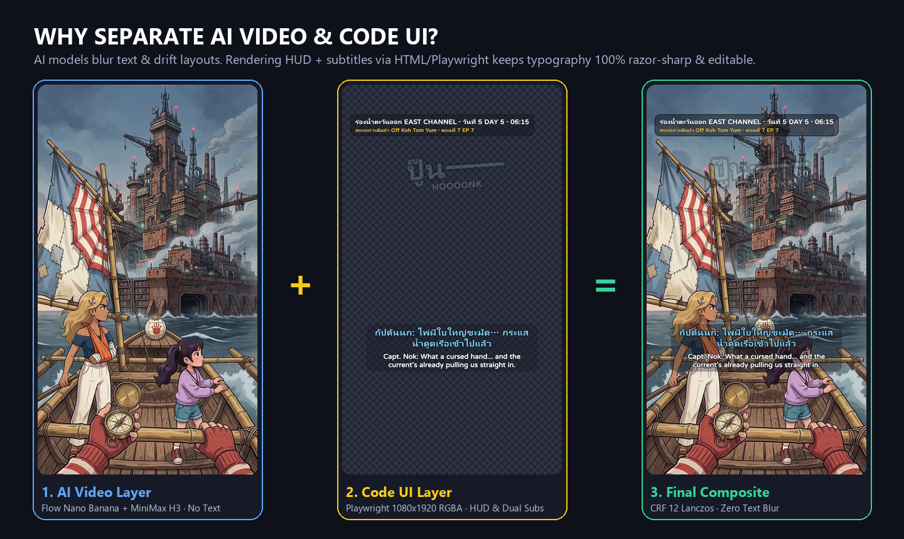
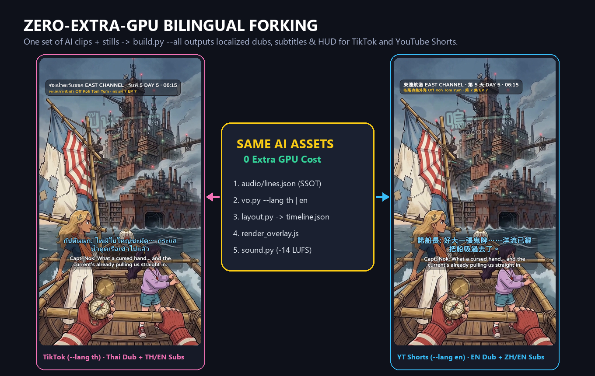
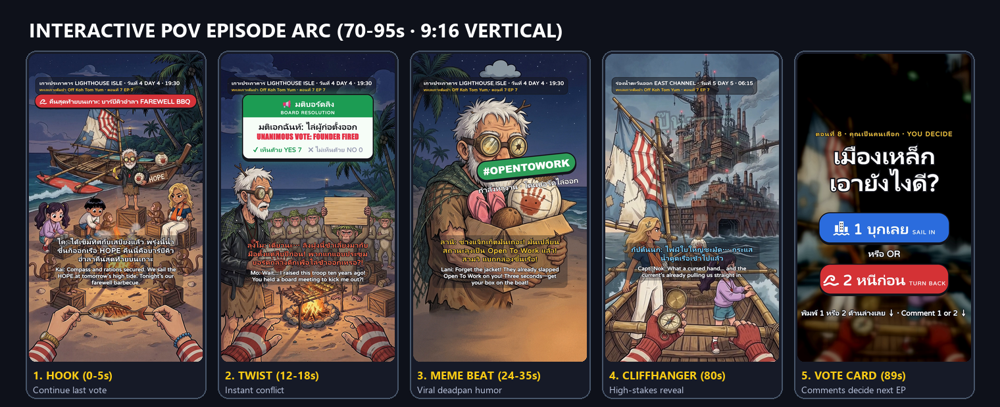
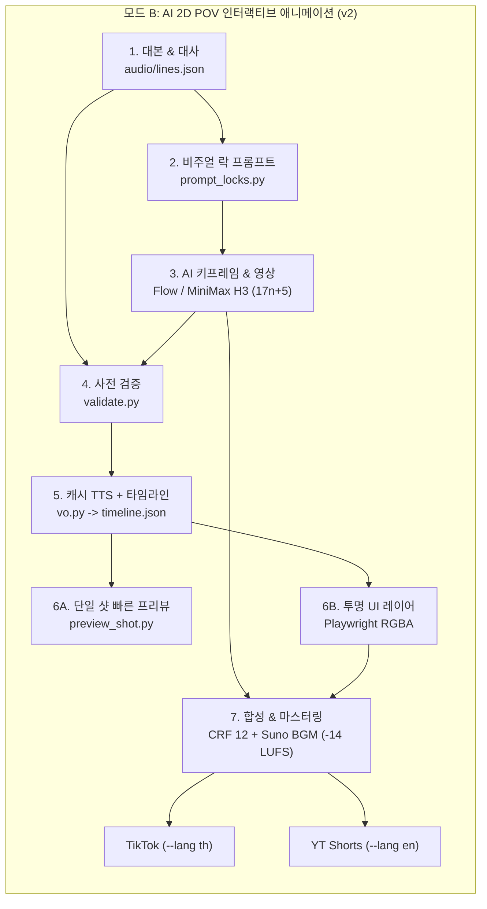

<p align="center"></p>

<h1 align="center">vlog-shorts-4k60 (v2)</h1>

<p align="center">
  <a href="README.md">繁體中文</a> ·
  <a href="README.en.md">English</a> ·
  <a href="README.ja.md">日本語</a> ·
  <b>한국어</b> ·
  <a href="README.th.md">ภาษาไทย</a>
</p>

<p align="center">Xgentrade, Claude Code, Codex, Antigravity, Cursor에서 바로 쓰는 <b>듀얼 모드 세로형 숏폼 제작 AI Agent Skill</b>:<br><b>모드 A</b>는 스마트폰 촬영본을 <b>4K 60fps 3개국어 Vlog Shorts</b>로 편집하고, <b>모드 B</b>는 대본을 <b>2D 잉크라인 POV 인터랙티브 애니메이션</b>으로 제작해 추가 GPU 비용 0원으로 TikTok과 YouTube Shorts 다국어 버전을 동시 출력합니다.</p>

<p align="center"></p>

---

## 왜 이렇게 설계했나요?

실사 브이로그든 AI 애니메이션이든 영상 원본을 브라우저로 재렌더링하거나 AI 모델에 자막을 직접 그리게 하면 **화질 저하, 글자 깨짐, 다국어 GPU 비용 2배** 문제가 발생합니다. 두 모드는 하나의 원칙을 공유합니다:

> **영상 소스(스마트폰 원본·AI 영상)는 절대 브라우저를 거치지 않으며, AI에게 글자를 맡기지 않습니다.** 브라우저는 투명 RGBA UI/자막 레이어만 렌더링하고 `ffmpeg`로 고화질 합성합니다.

### 1. AI 영상과 코드 렌더링 UI의 완전 분리
<p align="center"></p>

### 2. 추가 GPU 비용 0원의 다국어 분기
하나의 AI 영상·스틸 세트와 `audio/lines.json`으로 `python build.py --all` 한 번에 **TikTok(`--lang th`)**과 **YouTube Shorts(`--lang en`)** 버전을 동시 생성합니다.
<p align="center"></p>

### 3. 댓글이 다음 화를 결정하는 5비트 인터랙티브 구조
<p align="center"></p>

### 전체 아키텍처



---

## 빠른 설치

```text
이 Skill을 설치해 줘: https://github.com/lovemage/vlog-shorts-4k60
```

```bash
git clone https://github.com/lovemage/vlog-shorts-4k60 ~/.claude/skills/vlog-shorts-4k60
python ~/.claude/skills/vlog-shorts-4k60/template_pov_comic/scripts/validate.py --doctor
```

## 라이선스

MIT License
