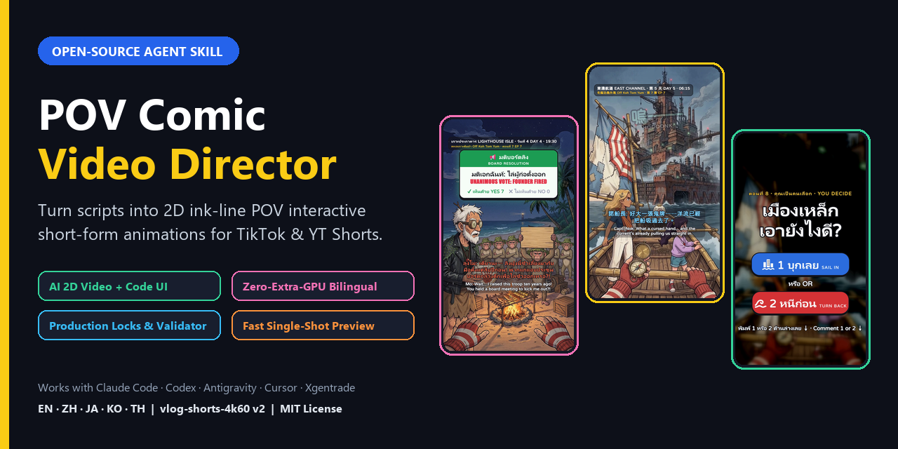
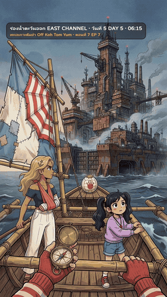
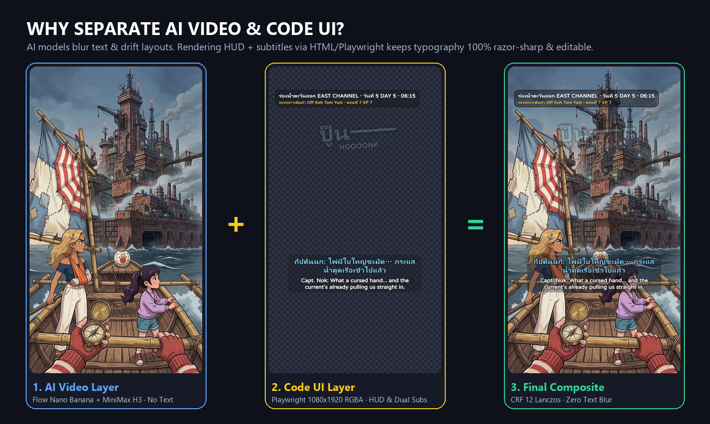
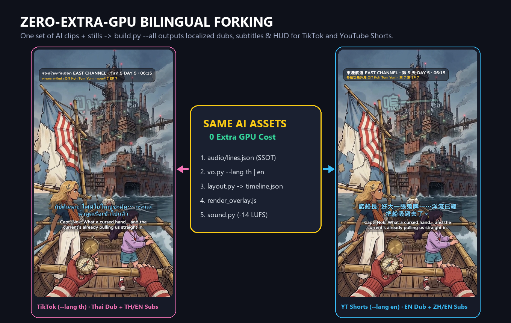
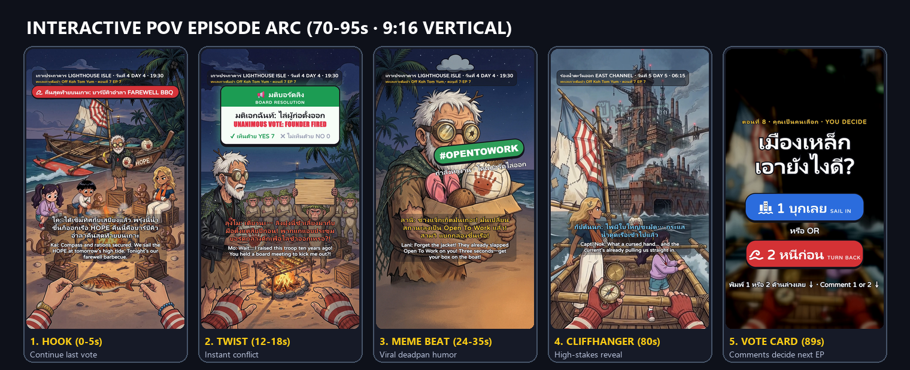
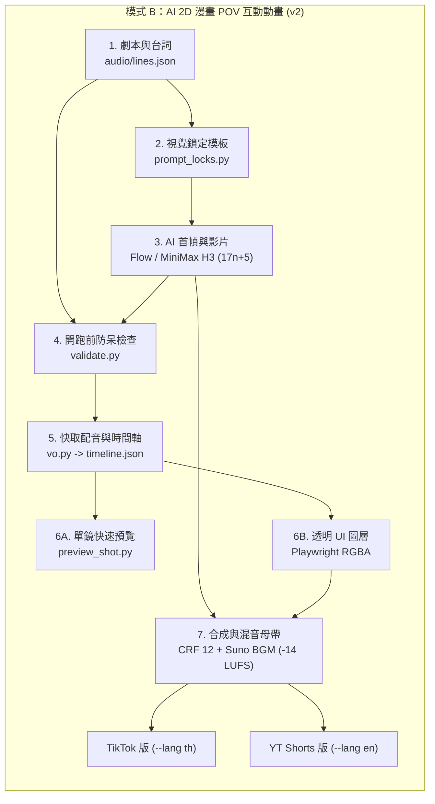
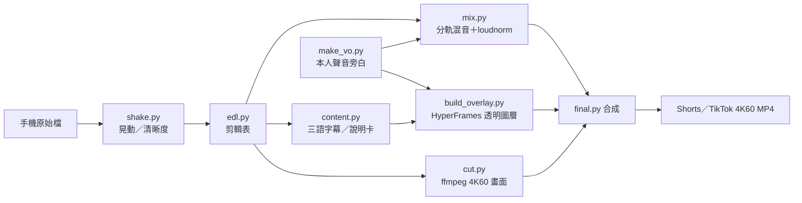

<p align="center"></p>

<h1 align="center">vlog-shorts-4k60 (v2)</h1>

<p align="center">
  <b>繁體中文</b> ·
  <a href="README.en.md">English</a> ·
  <a href="README.ja.md">日本語</a> ·
  <a href="README.ko.md">한국어</a> ·
  <a href="README.th.md">ภาษาไทย</a>
</p>

<p align="center">一套給所有 AI Agent（Xgentrade、Claude Code、Codex、Antigravity、Cursor）使用的<b>雙模式直式短影音製作 Skill</b>：<br><b>模式 A</b> 把手機實拍素材剪成 <b>4K 60fps 三語 Vlog Shorts</b>；<b>模式 B</b> 把劇本做成 <b>2D 墨線漫畫 POV 互動短影音</b>，一套 AI 畫面零額外算圖成本同時輸出 TikTok 與 YouTube Shorts 雙語版本。</p>

<p align="center"></p>

---

## 為什麼要這樣做？（核心原則）

不管是實拍手機 Vlog 還是 AI 生成的 2D 動畫，只要直接把畫面丟進瀏覽器（Remotion / HyperFrames）或讓 AI 影片模型直接畫字幕，就會遇到**畫面變糊、文字亂碼、多語重算成本翻倍**。所以這套 Skill 的兩大模式共用同一條鐵則：

> **底層畫面（手機原始檔或 AI 影片）永遠不經過瀏覽器，也不讓 AI 畫字。** 瀏覽器只負責渲染透明背景的銳利 UI、雙語／三語字幕與互動選擇卡，最後再用 `ffmpeg` 高畫質疊合。

| 模式 | 適用情境 | 底層畫面 | 透明 UI 圖層 | 成品規格 |
|---|---|---|---|---|
| **模式 A：實拍 Vlog 4K60**（`template/`） | 市集、祭典、美食、旅遊 Vlog | 手機原檔 `ffmpeg` lanczos 4K60 + `shake.py` 晃動過濾 | HyperFrames ProRes 4444 alpha | `2160×3840` 60fps（Shorts＋TikTok 雙剪輯） |
| **模式 B：AI 2D 漫畫 POV 動畫**（`template_pov_comic/`） | 日更互動連載短影音（觀眾留言決定下一集） | Flow Nano Banana + MiniMax H3（`17n+5` 逐秒節拍） | Playwright `1080×1920` RGBA 透明圖層 | `1080×1920` 30fps、`-14 LUFS`（零額外 GPU 雙語分流） |

---

## 模式 B（v2 新增）：AI 2D 墨線漫畫 POV 互動短影音

### 1. 為什麼把 AI 畫面與程式化 UI 徹底分離？
AI 影片模型負責「乾淨無字的 2D 墨線動態」；字幕、HUD 膠囊、角色色標與投票卡全由 HTML/CSS + Playwright 逐幀輸出透明 PNG 再疊合。銳化（`unsharp=5:5:0.45`）**只加在 AI 素材上**，文字永遠 100% 銳利，改台詞也不必重算影片。

<p align="center"></p>

### 2. 為什麼一套 AI 畫面能零成本輸出雙語版本？
全片時間軸、字幕、配音與 BGM 都讀同一份 `audio/lines.json`。AI 首幀與影片只需算一次，執行 `python build.py --all` 就能同時產出 **TikTok 泰語版（泰語配音＋泰大英小）** 與 **YouTube Shorts 英語版（英語配音＋中大英小）**，**零額外 GPU 算圖成本**。

<p align="center"></p>

### 3. 高留存 5 拍互動敘事結構
開頭 0–5 秒承接上集觀眾最高票留言 → 衝突爆發 → 冷面黑色幽默梗 → 高張力懸念 → 4 秒二選一投票卡（`1` vs `2`），讓留言自動推動隔天劇本。

<p align="center"></p>

### 完整自動化架構（Mermaid）



### 模式 B 內建效率工具（`template_pov_comic/scripts/`）

| 工具 | 用途 | 範例指令 |
|---|---|---|
| `validate.py` | 環境檢查（`--doctor`）與開跑前防呆（檢查 `lines.json`、H3 `17n+5` 幀數、禁詞、缺檔） | `python template_pov_comic/scripts/validate.py <ep_dir> --lang th,en` |
| `prompt_locks.py` | Flow / MiniMax H3 畫風與角色鎖定產生器＋自動對齊 `17n+5` 合法幀數 | `python template_pov_comic/scripts/prompt_locks.py --frames 8.5` |
| `preview_shot.py` | 單鏡局部預覽（只渲染 1 個鏡頭的透明 UI＋配音＋BGM，數秒驗收） | `python template_pov_comic/scripts/preview_shot.py <ep_dir> --shot s2a --lang th` |

---

## 模式 A（原有功能）：手機實拍 4K 60fps 三語 Vlog Shorts

<p align="center"></p>

- 📋 **素材分析與晃動偵測（`tools/shake.py`）**：每 0.5 秒評估手震與清晰度，只取穩定片段。
- ✂️ **EDL 剪輯表（`edl.py`）**：一份定義同時輸出 Shorts 與較長的 TikTok 版本。
- 🌏 **三語字幕＋在地說明卡（`content.py`）**：中／英／泰字幕掛在片段上，改剪輯不跑位。
- 🎙️ **本人聲音旁白＋分軌混音**：fal.ai 聲音複製＋BGM sidechain 閃避＋兩段式 loudnorm。



---

## 快速安裝（Agent Skill / Xgentrade / Claude Code / Codex / Antigravity）

直接對你的 AI Agent 說：

```text
幫我安裝這個 Skill：https://github.com/lovemage/vlog-shorts-4k60
```

或手動 clone 到本機 Skills 目錄：

```bash
git clone https://github.com/lovemage/vlog-shorts-4k60 ~/.claude/skills/vlog-shorts-4k60
python ~/.claude/skills/vlog-shorts-4k60/template_pov_comic/scripts/validate.py --doctor
```

## 授權

MIT License © OceanAds / lovemage
