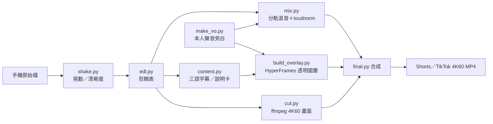

<p align="center"></p>

<h1 align="center">vlog-shorts-4k60</h1>

<p align="center">
  <b>繁體中文</b> ·
  <a href="README.en.md">English</a> ·
  <a href="README.zh-CN.md">简体中文</a> ·
  <a href="README.ja.md">日本語</a> ·
  <a href="README.es.md">Español</a>
</p>

<p align="center">把一次出遊拍的手機素材，剪成清晰的 <b>4K 60fps 直式 vlog Shorts</b>：三語字幕、在地說明卡、本人聲音的 AI 旁白、配樂與音量對齊，一次輸出 YouTube Shorts 和 TikTok 兩個版本。</p>

---

## 這是什麼

這是一個 [Claude Code](https://claude.com/claude-code) **skill**，也是一套可以直接執行的專案範本。它把「市集、祭典、美食、旅遊日」這類手機 vlog 的剪輯流程寫成腳本：

- 📋 **素材分析**：逐支讀取解析度、幀率和內容，找出重複鏡頭
- 🎯 **晃動偵測**：以每 0.5 秒為一格，算出鏡頭移動速度、手震和清晰度，只用穩定的片段
- ✂️ **EDL 剪輯表**：用一個 Python 檔定義整支影片，Shorts 和 TikTok 兩版共用
- 🌏 **三語字幕與在地說明卡**：例如中／英／泰，字幕和說明卡都掛在片段上，改剪輯時不會跑位
- 🎙️ **本人聲音旁白**：選用 fal.ai MiniMax 的聲音複製
- 🎵 **混音**：對白、環境音、音效、BGM 分軌處理，BGM 遇到人聲自動壓低，兩段式 loudnorm 對齊頻道音量
- 📝 **上傳文案與封面**：地點研究、說明欄範本、封面做法

## 為什麼畫質比較清楚

<p align="center"></p>

HTML 轉影片的工具（HyperFrames、Remotion 等）都是「瀏覽器逐格截圖再編碼」。手機素材走這條路會多一次轉碼，預設的 1080p30 又會讓畫面更糊。所以這套流程的核心規則是：

> **素材永遠不經過瀏覽器。** 瀏覽器只負責畫文字和圖卡。

<p align="center"></p>

| 圖層 | 用什麼做 | 格式 |
|---|---|---|
| 畫面 | ffmpeg 直接讀原始檔：lanczos 放大到 2160×3840、置中裁切、只對亮度做輕微銳化 | x264 CRF 12、60 fps |
| 圖層（標題、字幕、說明卡、資訊卡） | HyperFrames，透明背景，直接以 portrait-4k 輸出 | ProRes 4444 帶 alpha、60 fps |
| 聲音 | ffmpeg 分軌混音，BGM 依人聲 sidechain 壓低 | 48 kHz 24-bit |
| 成品 | ffmpeg 先以 yuv444 疊合，最後轉 yuv420p | x264 CRF 14、AAC 320k |

文字不會被銳化，也不會被放大，畫面也不會經過瀏覽器重新渲染。



## 挑鏡頭

<p align="center"></p>

`tools/shake.py` 用相位相關法算出每 0.5 秒的畫面位移速度和手震程度，再用 Laplacian 變異數判斷清晰度，每支素材印成一行：

```
01 VID20261112163937.mp4  13.4s | o X X o X . o o o o X X o . X o o X X X ...
04 VID20261112164137.mp4   1.6s | X o o
```

`.` 穩定、`o` 可用、`X` 太快或太晃、`b` 模糊。只從 `.` 和短的 `o` 段落取鏡頭。

## 快速開始

需要：ffmpeg、Python 3.10 以上（`pip install opencv-python numpy fonttools`）、Node 20 以上。旁白和配樂需要 fal.ai key，可選。

```bash
# 1. 把範本複製到素材資料夾裡（預設素材在上一層）
cp -r template/ /path/to/clips/short && cd /path/to/clips/short

# 2. 字型、素材表、晃動分析
python tools/get_fonts.py
python edl.py --sources
python tools/shake.py

# 3. 編輯 edl.py（剪輯表）和 content.py（畫面上的字），放入 assets/music/bgm.wav
#    （或用 FAL_KEY=... python tools/gen_audio.py 生成）

# 4. 選用：本人聲音旁白
VOICE_ID=your_minimax_voice_id FAL_KEY=... python tools/make_vo.py

# 5. 預覽
python tools/cut.py && python tools/build_overlay.py && python tools/subset_font.py \
  && python tools/mix.py && python tools/proxy.py
npx hyperframes preview

# 6. 輸出所有版本
bash tools/render_all.sh            # 或: bash tools/render_all.sh shorts
```

成品在 `renders/<title>_Shorts_4K60.mp4` 和 `renders/<title>_TikTok_4K60.mp4`。

## 當作 Claude Code skill 使用

```bash
git clone https://github.com/<you>/vlog-shorts-4k60 ~/.claude/skills/vlog-shorts-4k60
```

之後對 Claude 說「把這個資料夾的素材剪成 4K60 Shorts，中英泰字幕」，它就會照 [`SKILL.md`](SKILL.md) 的 12 個步驟進行：brief → 研究地點 → 素材分析 → 晃動偵測 → 剪輯表 → 旁白 → 字幕 → 配樂 → 字型 → 預覽 → 輸出 → 文案與封面。

## 專案結構

```
SKILL.md                 給 Claude 的工作流程
template/
  edl.py                 剪輯表：素材、片段、版本、額外音軌
  content.py             畫面上所有文字：hook、字幕、說明卡、貼紙、資訊卡、字型、配色
  vo/script.example.json 旁白稿範例
  tools/                 shake / cut / build_overlay / subset_font / mix / proxy / final / render_all
                         make_vo / gen_audio / fal / get_fonts
references/
  research-and-info.md   地點研究與影片資訊範本
  cover.md               封面做法
docs/images/             README 圖片
```

## 防呆

- `cut.py` 會先檢查每個片段的入點加長度有沒有超過素材本身的長度。超過的話整支影片會悄悄變短，字幕和音軌也會全部錯位。
- `build_overlay.py` 會警告重疊的字幕。
- 金鑰和聲音 ID 只從環境變數讀取，`.gitignore` 已經排除 `work/`、`renders/`、旁白快取和 `.env`。

## 授權

MIT。預設字型 Noto Sans TC 和 Kanit 採用 SIL Open Font License，由 `get_fonts.py` 從 google/fonts 下載。README 插圖以 meta/muse-image 生成。
