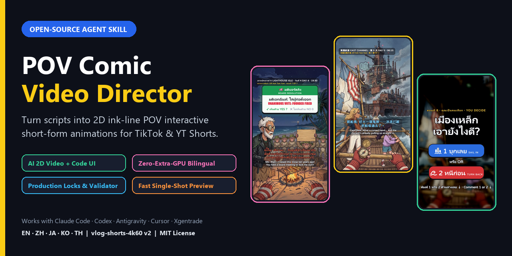
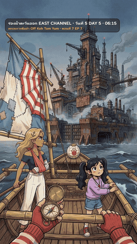
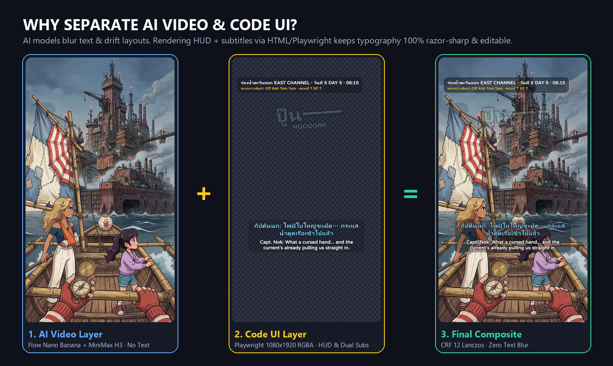
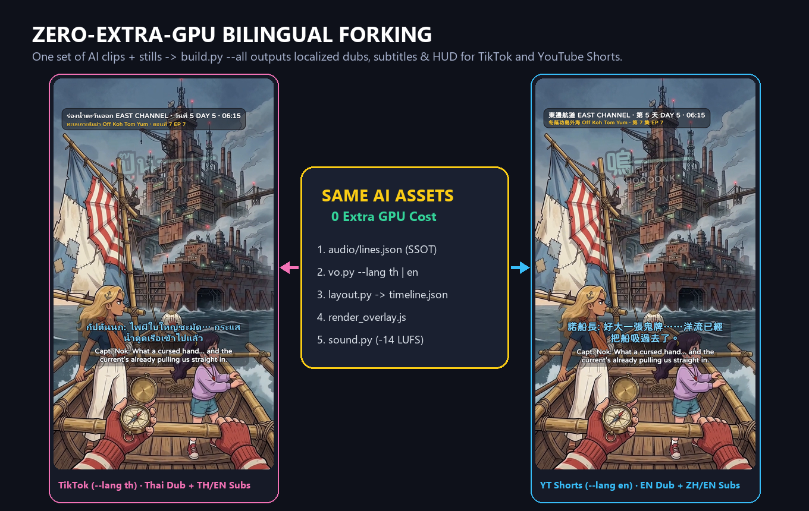
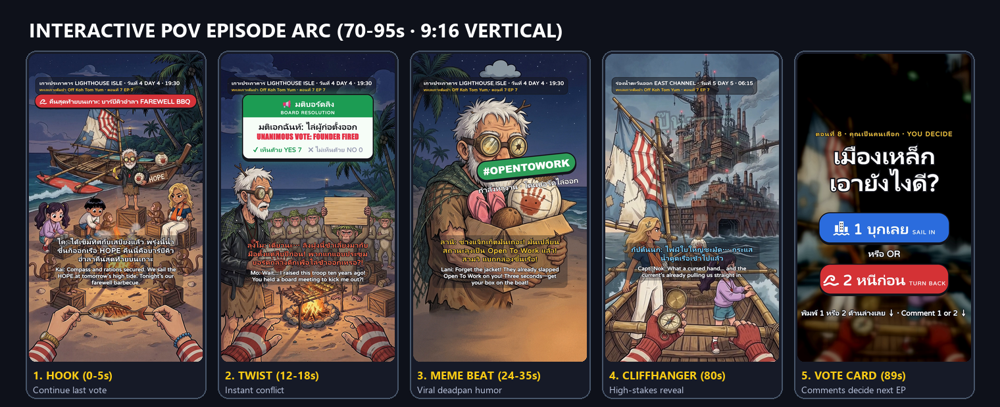
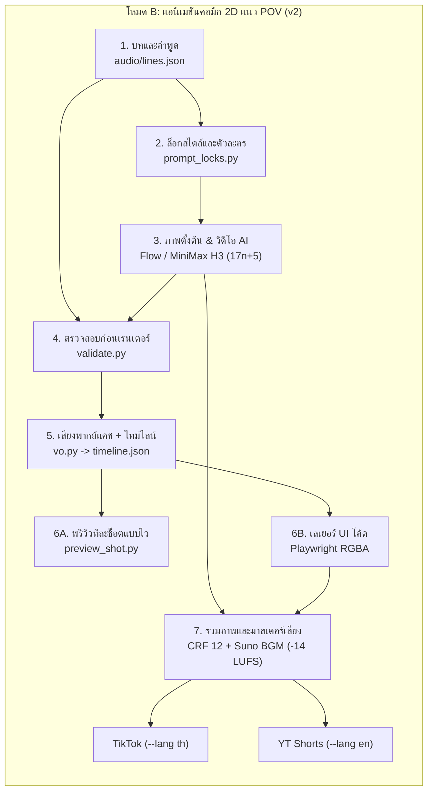

<p align="center"></p>

<h1 align="center">vlog-shorts-4k60 (v2)</h1>

<p align="center">
  <a href="README.md">繁體中文</a> ·
  <a href="README.en.md">English</a> ·
  <a href="README.ja.md">日本語</a> ·
  <a href="README.ko.md">한국어</a> ·
  <b>ภาษาไทย</b>
</p>

<p align="center"><b>AI Agent Skill แบบโอเพนซอร์ส 2 โหมด</b> สำหรับ Xgentrade, Claude Code, Codex, Antigravity และ Cursor:<br><b>โหมด A</b> ตัดคลิปมือถือเป็น <b>Vlog Shorts 4K 60fps 3 ภาษา</b> และ <b>โหมด B</b> เปลี่ยนบทเป็น<b>แอนิเมชันคอมิก 2D แนว POV แบบอินเทอร์แอคทีฟ</b> แตกเวอร์ชันสองภาษาลง TikTok และ YouTube Shorts โดย<b>ไม่เสียค่า GPU เพิ่ม</b></p>

<p align="center"></p>

---

## ทำไมต้องออกแบบเวิร์กโฟลว์แบบนี้?

ไม่ว่าจะเป็นคลิป Vlog จากมือถือหรือแอนิเมชัน AI หากให้เบราว์เซอร์เรนเดอร์วิดีโอซ้ำหรือให้ AI เขียนซับไตเติลลงภาพตรงๆ ภาพจะเบลอ ตัวหนังสือเพี้ยน และต้องเสียค่า GPU ซ้ำเมื่อทำหลายภาษา ทั้งสองโหมดจึงยึดกฎเหล็กข้อเดียวกัน:

> **ไฟล์วิดีโอต้นฉบับ (คลิปมือถือหรือวิดีโอ AI) จะไม่ผ่านเบราว์เซอร์ และไม่ให้ AI สร้างตัวหนังสือเด็ดขาด** เบราว์เซอร์ทำหน้าที่เรนเดอร์เฉพาะเลเยอร์ UI/ซับไตเติลพื้นหลังโปร่งใส แล้วรวมภาพความละเอียดสูงด้วย `ffmpeg`

### 1. แยกวิดีโอ AI ออกจาก UI ที่เรนเดอร์ด้วยโค้ด
<p align="center"></p>

### 2. แตกเวอร์ชันสองภาษาโดยไม่เสียค่า GPU เพิ่ม (Zero-Extra-GPU)
ใช้คลิป AI และภาพนิ่งชุดเดียวกันทั้งหมด ขับเคลื่อนจาก `audio/lines.json` เพียงไฟล์เดียว รัน `python build.py --all` เพื่อสร้างทั้ง **TikTok (`--lang th`)** และ **YouTube Shorts (`--lang en`)** ในคำสั่งเดียว
<p align="center"></p>

### 3. โครงสร้างเรื่อง 5 จังหวะที่ให้คอมเมนต์กำหนดตอนต่อไป
<p align="center"></p>

### สถาปัตยกรรมระบบ



---

## ติดตั้งอย่างรวดเร็ว

```text
ติดตั้ง Skill นี้ให้หน่อย: https://github.com/lovemage/vlog-shorts-4k60
```

```bash
git clone https://github.com/lovemage/vlog-shorts-4k60 ~/.claude/skills/vlog-shorts-4k60
python ~/.claude/skills/vlog-shorts-4k60/template_pov_comic/scripts/validate.py --doctor
```

## สัญญาอนุญาต

MIT License
