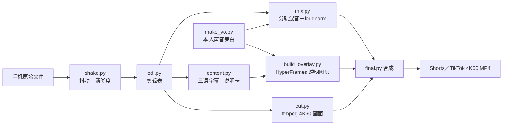

<p align="center"></p>

<h1 align="center">vlog-shorts-4k60</h1>

<p align="center">
  <a href="README.md">繁體中文</a> ·
  <a href="README.en.md">English</a> ·
  <b>简体中文</b> ·
  <a href="README.ja.md">日本語</a> ·
  <a href="README.es.md">Español</a>
</p>

<p align="center">把一次出游拍的手机素材，剪成清晰的 <b>4K 60fps 竖屏 vlog Shorts</b>：三语字幕、在地说明卡、本人声音的 AI 旁白、配乐与响度对齐，一次输出 YouTube Shorts 和 TikTok 两个版本。</p>

---

## 这是什么

这是一个 [Claude Code](https://claude.com/claude-code) **skill**，也是一套可以直接运行的项目模板。它把“集市、节庆、美食、旅行日”这类手机 vlog 的剪辑流程写成了脚本：

- 📋 **素材分析**：逐个读取分辨率、帧率和内容，找出重复镜头
- 🎯 **抖动检测**：以每 0.5 秒为一格，算出镜头移动速度、手抖和清晰度，只用稳定的片段
- ✂️ **EDL 剪辑表**：用一个 Python 文件定义整支视频，Shorts 和 TikTok 两版共用
- 🌏 **三语字幕与在地说明卡**：例如中／英／泰，字幕和说明卡都挂在片段上，改剪辑时不会错位
- 🎙️ **本人声音旁白**：可选，使用 fal.ai MiniMax 声音克隆
- 🎵 **混音**：对白、环境音、音效、BGM 分轨处理，BGM 遇到人声自动压低，两遍 loudnorm 对齐频道响度
- 📝 **上传文案与封面**：地点调研、简介模板、封面做法

## 为什么画质更清晰

<p align="center"></p>

HTML 转视频的工具（HyperFrames、Remotion 等）都是“浏览器逐帧截图再编码”。手机素材走这条路会多一次转码，默认的 1080p30 又会让画面更糊。所以这套流程的核心规则是：

> **素材永远不经过浏览器。** 浏览器只负责画文字和图卡。

<p align="center"></p>

| 图层 | 用什么做 | 格式 |
|---|---|---|
| 画面 | ffmpeg 直接读原始文件：lanczos 放大到 2160×3840、居中裁切、只对亮度做轻微锐化 | x264 CRF 12、60 fps |
| 图层（标题、字幕、说明卡、信息卡） | HyperFrames，透明背景，直接以 portrait-4k 输出 | ProRes 4444 带 alpha、60 fps |
| 声音 | ffmpeg 分轨混音，BGM 按人声 sidechain 压低 | 48 kHz 24-bit |
| 成片 | ffmpeg 先以 yuv444 叠加，最后转 yuv420p | x264 CRF 14、AAC 320k |

文字不会被锐化，也不会被放大，画面也不会经过浏览器重新渲染。



## 挑镜头

<p align="center"></p>

`tools/shake.py` 用相位相关法算出每 0.5 秒的画面位移速度和手抖程度，再用 Laplacian 方差判断清晰度，每个素材打印成一行：

```
01 VID20261112163937.mp4  13.4s | o X X o X . o o o o X X o . X o o X X X ...
04 VID20261112164137.mp4   1.6s | X o o
```

`.` 稳定、`o` 可用、`X` 太快或太晃、`b` 模糊。只从 `.` 和短的 `o` 段落取镜头。

## 快速开始

需要：ffmpeg、Python 3.10 以上（`pip install opencv-python numpy fonttools`）、Node 20 以上。旁白和配乐需要 fal.ai key，可选。macOS／Linux 请把命令中的 `python` 换成 `python3`。

```bash
# 1. 把模板复制到素材文件夹里（默认素材在上一层）
cp -r template/ /path/to/clips/short && cd /path/to/clips/short

# 2. 字体、素材表、抖动分析
python tools/get_fonts.py
python edl.py --sources
python tools/shake.py

# 3. 编辑 edl.py（剪辑表）和 content.py（画面上的字），放入 assets/music/bgm.wav
#    （或用 FAL_KEY=... python tools/gen_audio.py 生成）

# 4. 可选：本人声音旁白
cp vo/script.example.json vo/script.json   # 再改成你自己的旁白稿
VOICE_ID=your_minimax_voice_id FAL_KEY=... python tools/make_vo.py

# 5. 预览
python tools/cut.py && python tools/build_overlay.py && python tools/subset_font.py \
  && python tools/mix.py && python tools/proxy.py
npx --yes hyperframes@0.8.141 preview

# 6. 输出所有版本
bash tools/render_all.sh            # 或: bash tools/render_all.sh shorts
```

成片在 `renders/<title>_Shorts_4K60.mp4` 和 `renders/<title>_TikTok_4K60.mp4`。

## 作为 Claude Code skill 使用

```bash
git clone https://github.com/lovemage/vlog-shorts-4k60 ~/.claude/skills/vlog-shorts-4k60
```

之后对 Claude 说“把这个文件夹的素材剪成 4K60 Shorts，中英泰字幕”，它就会按照 [`SKILL.md`](SKILL.md) 的 12 个步骤进行：brief → 调研地点 → 素材分析 → 抖动检测 → 剪辑表 → 旁白 → 字幕 → 配乐 → 字体 → 预览 → 输出 → 文案与封面。

## 项目结构

```
SKILL.md                 给 Claude 的工作流程
template/
  edl.py                 剪辑表：素材、片段、版本、额外音轨
  content.py             画面上所有文字：hook、字幕、说明卡、贴纸、信息卡、字体、配色
  vo/script.example.json 旁白稿示例
  tools/                 shake / cut / build_overlay / subset_font / mix / proxy / final / render_all
                         make_vo / gen_audio / fal / get_fonts
references/
  research-and-info.md   地点调研与视频信息模板
  cover.md               封面做法
docs/images/             README 图片
```

## 防呆

- `cut.py` 会先检查每个片段的入点加时长有没有超过素材本身的长度。超过的话整支视频会悄悄变短，字幕和音轨也会全部错位。
- `build_overlay.py` 会警告重叠的字幕。
- 密钥和声音 ID 从环境变量（或已被 gitignore 的 `.env`）读取，`.gitignore` 已经排除 `work/`、`renders/`、旁白缓存和 `.env`。

## 许可

MIT。默认字体 Noto Sans TC 和 Kanit 采用 SIL Open Font License，由 `get_fonts.py` 从 google/fonts 下载。README 插图用 meta/muse-image 生成。
